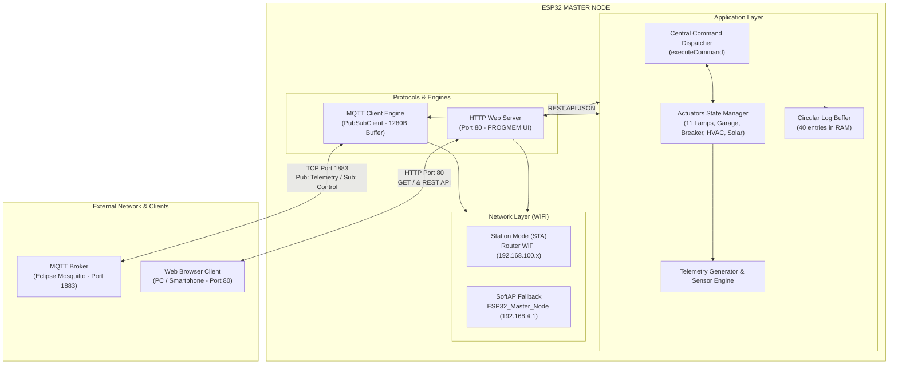
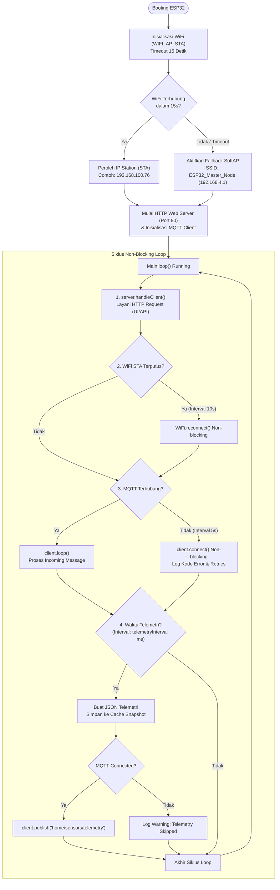

# Arsitektur Sistem dan Spesifikasi Komunikasi Data ESP32 Master Node

Dokumen ini menjelaskan rancangan arsitektur, saluran komunikasi, serta skema data yang berjalan pada modul ESP32 Master Node di dalam ekosistem Home IoT Service.

---

## 1. Ikhtisar Sistem

ESP32 Master Node berfungsi sebagai pengendali tepi (Edge IoT Controller) dan gateway lokal. Modul ini bertanggung jawab untuk:
- Mengumpulkan dan mempublikasikan data telemetri sensor lingkungan, daya listrik, dan sistem solar PV.
- Menerima dan mengeksekusi instruksi kontrol aktuator (11 zona saklar lampu, pintu garasi, pemutus arus dapur, dan unit HVAC).
- Menyediakan dashboard kendali lokal dan penampil log sistem secara real-time melalui antarmuka web berbasis HTTP.
- Menjaga kontinuitas operasional secara non-blocking melalui mekanisme penanganan pemulihan koneksi WiFi dan broker MQTT.

---

## 2. Diagram Blok Arsitektur




---

## 3. Komponen Utama Perangkat Lunak

### 3.1 Network Manager
- **WIFI_AP_STA**: Menjalankan mode station dan access point secara paralel.
- **Batas Waktu Koneksi**: Upaya awal dibatasi 15 detik (`WIFI_SETUP_TIMEOUT_MS`). Jika belum tersambung, AP mandiri `ESP32_Master_Node` diaktifkan dengan IP `192.168.4.1`.
- **Non-blocking Reconnect**: Pemeriksaan status WiFi dilakukan di dalam fungsi `loop()` setiap 10 detik tanpa menghentikan eksekusi program.

### 3.2 MQTT Engine
- **Mekanisme Reconnect Non-blocking**: Reconnect broker dijadwalkan setiap 5 detik tanpa pemanggilan `delay()` yang membekukan sistem.
- **Identifikasi Unik**: Client ID dihasilkan dinamis berbasis alamat MAC (`ESP32_Infra_Node_<MAC_SUFFIX>`) guna menghindari konflik identitas pada broker bersama.
- **Diagnostik Error**: Nilai status koneksi `client.state()` diterjemahkan menjadi teks deskriptif (misal: `CONNECT_FAILED (Broker Unreachable)`, `CONNECTION_LOST`, dsb.).

### 3.3 Central Command Dispatcher
Fungsi `executeCommand(JsonObject root, String &err)` menjadi jalur tunggal pemrosesan instruksi. Sumber perintah dari payload MQTT maupun payload REST API diproses melalui fungsi yang sama, menjamin keseragaman validasi tipe data, batas nilai, dan pencatatan log.

### 3.4 Circular Log Buffer
- Kapasitas: 40 rekaman log tersimpan di SRAM.
- Setiap rekaman menyimpan timestamp waktu aktif (*uptime*), kategori level log (`INFO`, `WARN`, `ERROR`, `ACTION`), serta pesan teks.
- Log dialirkan simultan ke Serial Monitor (115200 baud) dan memori buffer untuk diakses oleh antarmuka web.

---

## 4. Spesifikasi Saluran Komunikasi

### 4.1 Protokol MQTT

| Atribut | Nilai |
| :--- | :--- |
| Default Broker Port | 1883 (TCP non-TLS) |
| Topik Telemetri (Publish) | `home/sensors/telemetry` |
| Topik Kontrol (Subscribe) | `home/actuators/control` |
| QoS | 0 (At most once delivery) |
| Format Payload | JSON UTF-8 |

### 4.2 Protokol HTTP REST API

| Endpoint | Metode | Tipe Konten | Fungsi |
| :--- | :--- | :--- | :--- |
| `/` | GET | `text/html` | Mengirim dashboard web lengkap (HTML, CSS, JS tertanam di PROGMEM). |
| `/api/status` | GET | `application/json` | Mengembalikan status lengkap perangkat, jaringan, aktuator, dan sensor. |
| `/api/logs` | GET | `application/json` | Mengembalikan array riwayat log dari circular buffer. |
| `/api/control` | POST | `application/json` | Menerima perintah kontrol aktuator atau konfigurasi sistem. |
| `/api/restart` | POST | `application/json` | Memulai proses reboot perangkat secara terkontrol. |

---

## 5. Struktur dan Skema Data

### 5.1 Telemetri Sensor (Publish MQTT & `last_telemetry`)

Diterbitkan secara berkala sesuai `telemetryInterval` (default: 2000 ms) ke topik `home/sensors/telemetry`.

```json
{
  "pv_array_voltage": 68.5,
  "pv_array_current": 12.4,
  "pv_power_watts": 850.0,
  "solar_yield_kwh": 7.45,
  "panel_temp_c": 38.6,
  "solar_charger_active": true,
  "mains_voltage": 223.5,
  "house_power_w": 340.0,
  "ups_battery_pct": 98.0,
  "ups_load_pct": 14.2,
  "rack_temp_c": 24.3,
  "temp_outdoor_c": 29.1,
  "humidity_pct": 58.0,
  "water_leak": false,
  "ping_gateway_ms": 3.4,
  "rssi_dbm": -52,
  "esp_free_heap_kb": 226,
  "lamps": {
    "living_room": true,
    "main_room": false,
    "garage": false,
    "kitchen": true,
    "stair_garage": false,
    "stair_fl2": false,
    "yard_front": true,
    "yard_side": false,
    "yard_back": false,
    "server_room": true,
    "electrical_room": false
  },
  "lamp_status": true,
  "garage_status": false,
  "hvac_power": true,
  "hvac_target_temp": 22
}
```

#### Deskripsi Field Telemetri:
- `pv_array_voltage` (float): Tegangan string solar PV (Volt).
- `pv_array_current` (float): Arus string solar PV (Ampere).
- `pv_power_watts` (float): Daya keluaran aktif solar PV (Watt).
- `solar_yield_kwh` (float): Akumulasi produksi harian solar PV (kWh).
- `panel_temp_c` (float): Suhu permukaan panel solar (Celsius).
- `solar_charger_active` (boolean): Status relay charger MPPT.
- `mains_voltage` (float): Tegangan jaringan listrik PLN (Volt).
- `house_power_w` (float): Total konsumsi daya rumah aktif (Watt).
- `ups_battery_pct` (float): Kapasitas sisa baterai cadangan UPS (%).
- `ups_load_pct` (float): Beban inverter UPS terhadap kapasitas total (%).
- `rack_temp_c` (float): Suhu udara ruang rack server (Celsius).
- `temp_outdoor_c` (float): Suhu udara luar ruangan (Celsius).
- `humidity_pct` (float): Kelembaban relatif udara (%).
- `water_leak` (boolean): Status deteksi sensor kebocoran air.
- `ping_gateway_ms` (float): Latensi koneksi ke default gateway (ms).
- `rssi_dbm` (integer): Kuat sinyal WiFi yang diterima (dBm).
- `esp_free_heap_kb` (integer): Sisa memori heap ESP32 (Kilobyte).
- `lamps` (object): Objek status ke-11 zona saklar lampu.
- `garage_status` (boolean): Status pintu garasi (`true`: terbuka, `false`: tertutup).
- `hvac_power` (boolean): Status daya unit AC pendingin.
- `hvac_target_temp` (integer): Target suhu termostat AC (Celsius).

---

### 5.2 Perintah Kontrol (Subscribe MQTT & POST `/api/control`)

Semua instruksi wajib memiliki kunci `"command"`.

#### A. Kontrol Saklar Lampu (`set_lamp`)
1. Menyalakan/mematikan satu zona tertentu:
```json
{
  "command": "set_lamp",
  "room": "yard_front",
  "state": true
}
```
*Daftar nilai `room`: `living_room`, `main_room`, `garage`, `kitchen`, `stair_garage`, `stair_fl2`, `yard_front`, `yard_side`, `yard_back`, `server_room`, `electrical_room`.*

2. Master Switch (semua lampu sekaligus):
```json
{
  "command": "set_lamp",
  "room": "all",
  "state": false
}
```

3. Kompatibilitas Lampu Lama (tanpa parameter `room`):
```json
{
  "command": "set_lamp",
  "state": true
}
```
*(Mengendalikan `living_room` secara default).*

#### B. Kontrol Pintu Garasi (`set_garage`)
```json
{
  "command": "set_garage",
  "state": "open"
}
```
*(Nilai `state` menerima format boolean `true`/`false` atau string `"open"`/`"closed"`).*

#### C. Kontrol Pemutus Arus Dapur (`set_breaker`)
```json
{
  "command": "set_breaker",
  "state": true
}
```

#### D. Kontrol HVAC / AC Ruangan (`set_hvac`)
```json
{
  "command": "set_hvac",
  "power": true,
  "target_temp": 21
}
```
*Validasi: `target_temp` harus berada pada rentang 16 hingga 32 Celsius.*

#### E. Kontrol Charger dan Inverter Solar (`set_solar`)
```json
{
  "command": "set_solar",
  "charge_enabled": true,
  "max_watts": 3500
}
```
*Validasi: `max_watts` harus berada pada rentang 100 hingga 15000 Watt.*

#### F. Konfigurasi Interval Telemetri (`set_config`)
```json
{
  "command": "set_config",
  "telemetry_interval_ms": 3000
}
```
*Validasi: rentang nilai diperbolehkan antara 500 ms hingga 60000 ms.*

#### G. Reboot Modul (`reboot_esp`)
```json
{
  "command": "reboot_esp"
}
```

---

### 5.3 Respon Endpoint Status (`GET /api/status`)

Mengembalikan representasi status lengkap untuk sinkronisasi antarmuka web:

```json
{
  "wifi_connected": true,
  "wifi_ssid": "said",
  "ip_address": "192.168.100.76",
  "wifi_rssi": -50,
  "mqtt_connected": false,
  "mqtt_server": "test.mosquitto.org",
  "mqtt_port": 1883,
  "mqtt_state_code": -2,
  "mqtt_state_desc": "CONNECT_FAILED (Broker Unreachable)",
  "mqtt_retries": 18,
  "uptime_sec": 95,
  "free_heap_kb": 224,
  "lamps": {
    "living_room": true,
    "main_room": false,
    "garage": false,
    "kitchen": true,
    "stair_garage": false,
    "stair_fl2": false,
    "yard_front": true,
    "yard_side": false,
    "yard_back": false,
    "server_room": true,
    "electrical_room": false
  },
  "lamp_status": true,
  "garage_status": false,
  "kitchen_breaker": true,
  "hvac_power": true,
  "hvac_target_temp": 22,
  "solar_charge_enabled": true,
  "solar_max_watts": 2400,
  "telemetry_interval_ms": 1000,
  "last_telemetry": {
    "pv_array_voltage": 68.5,
    "pv_array_current": 12.4,
    "pv_power_watts": 850.0,
    "solar_yield_kwh": 7.45,
    "panel_temp_c": 36.4,
    "mains_voltage": 223.5,
    "house_power_w": 340.0,
    "ups_battery_pct": 98.0,
    "ups_load_pct": 14.2,
    "rack_temp_c": 23.8,
    "temp_outdoor_c": 28.5,
    "humidity_pct": 60.0
  },
  "last_telemetry_age_s": 1
}
```

---

### 5.4 Respon Endpoint Log (`GET /api/logs`)

Mengembalikan array urutan log dari yang terlama ke yang terbaru:

```json
[
  {
    "time": "00:00:02",
    "level": "INFO",
    "msg": "WiFi connected! IP: 192.168.100.76 (RSSI: -50 dBm)"
  },
  {
    "time": "00:00:05",
    "level": "WARN",
    "msg": "MQTT reconnect #1 to test.mosquitto.org:1883..."
  },
  {
    "time": "00:01:29",
    "level": "ACTION",
    "msg": "All 11 Lamps -> ON"
  }
]
```

---

## 6. Diagram Alur Data dan Siklus Eksekusi



---

## 7. Penanganan Kesalahan (Error Handling Matrix)

| Skenario Kegagalan | Dampak Sistem | Mekanisme Pemulihan |
| :--- | :--- | :--- |
| Router WiFi mati atau SSID tidak ditemukan saat boot | ESP32 tidak dapat memperoleh IP lokal | Timeout 15 detik aktif, lalu SoftAP `ESP32_Master_Node` dinyalakan. Web UI tetap dapat diakses di `192.168.4.1`. `manageWifi()` mencoba sambung ulang tiap 10 detik. |
| Koneksi WiFi terputus di tengah operasi | Pengiriman telemetri dan kontrol via jaringan terhenti | `loop()` mendeteksi penurunan status tanpa delay. Reconnect dipanggil berkala setiap 10 detik. |
| Broker MQTT offline / alamat IP salah | Pengiriman pesan gagal | `manageMqtt()` mencoba sambung ulang tiap 5 detik secara non-blocking. Web server tetap merespons normal tanpa hang. |
| Payload JSON malformed atau tidak valid | Perintah tidak dikenali | Ditangkap oleh `deserializeJson()`. Sistem mencatat pesan kesalahan ke circular buffer dan membatalkan eksekusi tanpa crash. |
| Perintah dengan parameter di luar batas aman (misal suhu > 32 C) | Kerusakan atau nilai tidak realistis | Validasi internal menolak perintah dan mengembalikan pesan error eksplisit via log/HTTP response. |
| Ukuran pesan melebihi kapasitas buffer | Buffer overflow | Buffer PubSubClient ditingkatkan ke 1280 bytes. Pemeriksaan panjang payload dilakukan sebelum deserialisasi. |
