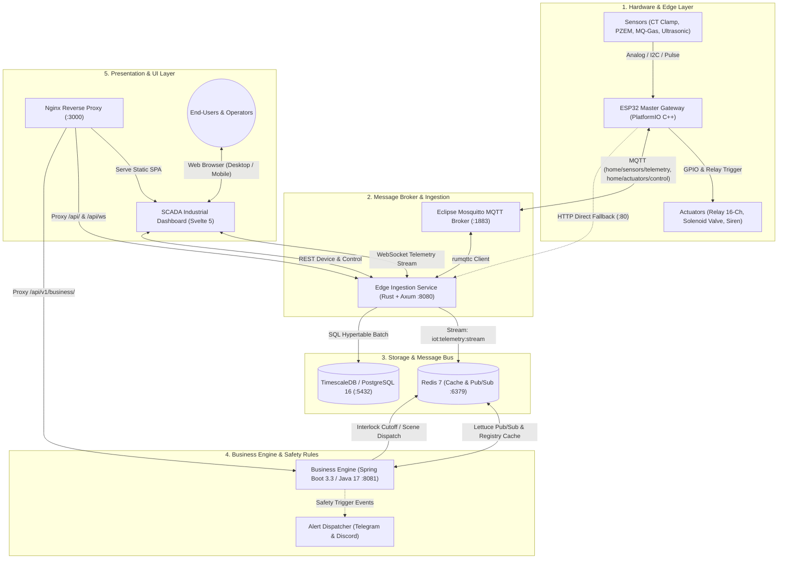

# Home IoT Control Center

[](#arsitektur-sistem-e2e)
[](#daftar-layanan--port-network)
[](#arsitektur-sistem-e2e)
[](#keamanan--hardening)
[](#lisensi)

**Home IoT Control Center** adalah platform manajemen energi dan otomasi rumah pintar berarsitektur **Hybrid Microservice**. Sistem ini memadukan penanganan telemetri I/O fisik berlatensi sub-milidetik (*Rust Ingestion Gateway*), mesin aturan keselamatan cerdas (*Spring Boot Business Engine*), dan antarmuka visual **Industrial SCADA** berbasis Svelte 5.

---

## Arsitektur Sistem E2E

Sistem mengadopsi pemisahan peran (*separation of concerns*) secara ketat antara penyerapan data cepat, pemrosesan logika bisnis, dan penyajian visual.



### Alur Kerja Data (End-to-End Pipeline)

1. **Jalur Telemetri (Sensor -> Visualisasi)**:
   - Node ESP32 membaca sensor listrik, gas, air, dan lingkungan, lalu menerbitkan payload JSON ke broker MQTT Mosquitto (`home/sensors/telemetry`).
   - Service **Rust Edge Ingestion** menyerap pesan via client `rumqttc`, mencatat data ke hypertable **TimescaleDB**, dan meneruskannya ke Redis channel `iot:telemetry:stream`.
   - Browser menerima stream telemetri real-time melalui WebSocket (`/api/ws`) tanpa polling HTTP.

2. **Jalur Kontrol & Smart Lock (Dashboard -> Aktuator)**:
   - Perintah pengguna dikirim dari Dashboard via REST `POST /api/devices/{id}/control`.
   - Backend Rust memvalidasi struktur parameter, memeriksa status proteksi **Smart Lock** (menolak perintah manual saat terkunci), dan menerbitkan pesan ke topic MQTT `home/actuators/control`.
   - Jika broker MQTT tidak merespons, backend secara transparan mencoba jalur *HTTP direct fallback* ke ESP32.

3. **Jalur Safety Interlock & Otomasi Cerdas**:
   - **Spring Boot Business Engine** memantau stream telemetri untuk mendeteksi bahaya:
     - **Beban PLN > 900W**: Mematikan beban sekunder secara bertahap sebelum MCB PLN trip.
     - **Konsentrasi Gas > 300 PPM / Kebocoran Air**: Menutup solenoid valve dan mengaktifkan sirene alarm darurat.
   - Mengirim notifikasi bahaya secara real-time ke **Telegram Bot** dan **Discord Webhook**.
   - Melacak sisa kuota pulsa listrik PLN prabayar (Rp & kWh), laju konsumsi harian (*burn-rate*), dan estimasi sisa hari.

---

## Struktur Monorepo

```
home-iot-control-center/
├── .env.example               # Template environment variables publik
├── docker-compose.yml         # Orkestrasi 6 container mikroservis
├── Devices/
│   └── ESP_Master/            # Firmware ESP32 (PlatformIO C++) dengan load_env.py
├── Service_Backend/           # Rust Ingestion Gateway (Axum + rumqttc + sqlx)
│   ├── mosquitto/config/      # Konfigurasi Eclipse Mosquitto broker
│   └── init-db/               # Skrip inisialisasi tabel TimescaleDB
├── Service_Business_Java/     # Business Engine (Spring Boot 3.3 + Lettuce Redis)
├── Dashboard/                 # SCADA Dashboard (Svelte 5 Runes + Nginx)
└── docs/                      # Dokumentasi teknis & spesifikasi kontrak
    ├── architecture/          # Topologi hybrid & ESP-NOW master-slave
    ├── services/              # Panduan internal Rust & Spring Boot
    ├── contracts/             # Kontrak event, skema JSON & API
    └── guides/                # Panduan flashing ESP32 & DuckDNS
```

---

## Daftar Layanan & Port Network

| Layanan | Container Name | Port Internal | Port Host | Jaringan Docker | Deskripsi |
|---|---|---|---|---|---|
| **SCADA Dashboard** | `iot_dashboard_ui` | `80` | `http://localhost:3000` | `iot_public_net` | Nginx reverse proxy & antarmuka Svelte 5 |
| **Edge Ingestion** | `iot_edge_ingestion_rust` | `8080` | `http://localhost:8080` | `iot_public_net`, `iot_internal_net` | Ingestion telemetri, REST API, & WebSocket stream (`/api/ws`) |
| **Business Engine** | `iot_business_engine_springboot` | `8081` | `http://localhost:8081` | `iot_public_net`, `iot_internal_net` | Aturan keselamatan, kuota PLN, scene engine, & webhook |
| **MQTT Broker** | `iot_mosquitto` | `1883` | `localhost:1883` | `iot_public_net` | Eclipse Mosquitto message broker untuk hardware node |
| **TimescaleDB** | `iot_timescaledb` | `5432` | `127.0.0.1:5432` | `iot_internal_net` | Database PostgreSQL 16 time-series (terikat loopback) |
| **Redis Cache** | `iot_redis` | `6379` | `127.0.0.1:6379` | `iot_internal_net` | In-memory message bus dengan autentikasi password |

---

## Keamanan & Hardening

Sistem ini telah diaudit dan diperkuat menggunakan metodologi security audit berlapis:

1. **Smart Lock Protection**:
   - Endpoint kontrol menolak perintah manual saat perangkat dalam status `is_locked`.
   - Percobaan bypass dengan parameter palsu (`source=AUTOMATION` atau `force=true`) ditolak secara ketat kecuali menyertakan header otorisasi internal (`X-Internal-Token`).
2. **Isolasi Database & Cache**:
   - Database TimescaleDB dan Redis dibatasi hanya ke loopback host `127.0.0.1` (tidak terekspos ke interface LAN `0.0.0.0`).
   - Redis diproteksi autentikasi password (`--requirepass`).
3. **CORS & Header Keamanan Nginx**:
   - Nginx dilengkapi header pertahanan: `X-Frame-Options: SAMEORIGIN`, `X-Content-Type-Options: nosniff`, `Referrer-Policy`, dan `Content-Security-Policy`.
   - CORS dibatasi secara ketat hanya untuk `localhost` dan subnet LAN privat (`192.168.*`, `10.*`).
4. **Validasi MQTT Path Injection**:
   - Input identifier perangkat diverifikasi dengan regex ketat (`^[a-z0-9_-]+$`) untuk mencegah eksploitasi MQTT topic traversal dan wildcard (`#`, `+`, `/`).
5. **Spring Boot Actuator Hardening**:
   - Endpoint kesehatan `/actuator/health` dikonfigurasi `show-details: never` untuk mencegah kebocoran informasi topologi internal server.
   - Endpoint administratif reset data energi diproteksi oleh validasi header `X-Admin-Key`.
6. **Batas Frame WebSocket**:
   - Koneksi WebSocket dibatasi pada ukuran frame dan payload maksimal `64 KB` untuk mencegah serangan kehabisan memori (*denial-of-service*).

---

## Panduan Memulai Cepat

### Prasyarat
- [Docker](https://www.docker.com/) & [Docker Compose](https://docs.docker.com/compose/) v2+
- (Opsional untuk development): Rust 1.80+, JDK 17+, Node.js 20+, PlatformIO Core.

### Menjalankan Seluruh Stack

1. **Clone repositori:**
   ```bash
   git clone git@github.com:Hilal06/home-iot-control-center.git
   cd home-iot-control-center
   ```

2. **Siapkan environment variables:**
   ```bash
   cp .env.example .env
   # Buka .env dan sesuaikan kredensial WiFi, MQTT, dan database lokal Anda
   ```

3. **Jalankan container dengan Docker Compose:**
   ```bash
   docker compose up -d --build
   ```

4. **Verifikasi status container:**
   ```bash
   docker ps
   # Pastikan seluruh container berstatus healthy / running
   ```

5. **Akses Dashboard:**
   - Buka browser di [http://localhost:3000](http://localhost:3000)

---

## Dokumentasi Terkait

- [Rancangan Arsitektur Hybrid](docs/architecture/hybrid-overview.md)
- [Topologi ESP-NOW Master-Slave](docs/architecture/espnow-master-slave-topology.md)
- [Rust Edge Ingestion Service](docs/services/rust-edge-ingestion.md)
- [Spring Boot Business Engine](docs/services/springboot-business-engine.md)
- [Spesifikasi Kontrak & API Reference](docs/contracts/events-and-apis.md)
- [Panduan Setup Kredensial ESP32](docs/guides/esp32-environment-setup.md)
- [Panduan Akses Jarak Jauh DuckDNS](docs/guides/duckdns-remote-access.md)

---

## Lisensi

Proyek ini dilisensikan di bawah lisensi [MIT](LICENSE).
