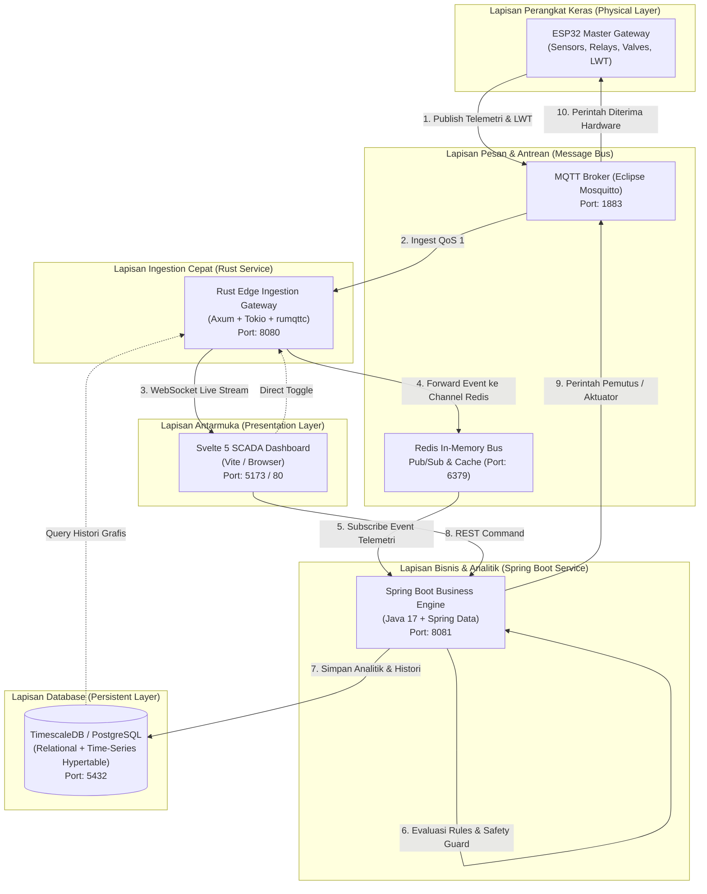
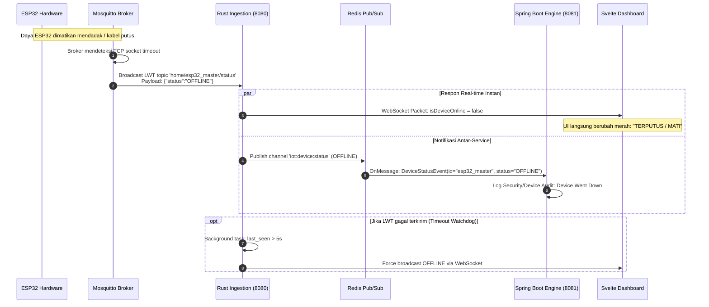

# Arsitektur Hybrid: Rust Edge Ingestion + Spring Boot Business Engine

Dokumen ini menjelaskan rancangan arsitektur backend **Hybrid Microservice** pada sistem **Home-IOT-Service**. Arsitektur ini memisahkan lapisan penanganan jaringan/hardware fisik berkecepatan tinggi dengan lapisan logika bisnis, aturan otomatisasi, dan akuntansi energi.

---

## 1. Latar Belakang & Motivasi

Sistem Home IoT memiliki dua karakteristik beban kerja (*workload*) yang sangat bertolak belakang:

1. **Edge I/O & Network Streaming (I/O Bound, Latency-Critical)**:
   - Menerima telemetri konstan setiap 1000ms dari mikrokontroler ESP32 via protokol MQTT.
   - Menyebarkan data telemetri secara *real-time* ke browser Dashboard melalui koneksi WebSocket persisten.
   - Memantau keaktifan perangkat fisik (*heartbeat watchdog*) dan pesan kematian darurat (*MQTT Last Will and Testament / LWT*).
2. **Business Rules, Scheduling & Accounting (CPU/Logic Bound, Enterprise-Oriented)**:
   - Mengevaluasi ambang batas keselamatan (*Safety Interlock*): kadar gas MQ, kebocoran air, dan proteksi kelebihan beban meteran listrik PLN 900W.
   - Mengatur strategi efisiensi energi: memanfaatkan surplus pembangkitan *Off-Grid Solar* (~2400 Wp) untuk pengisian baterai LiFePO4 (~4.8 kWh) dan beban sekunder.
   - Menjalankan penjadwalan waktu (*cron/scheduler*) untuk penyalaan lampu otomatis serta perhitungan akumulasi kWh dan estimasi biaya token PLN.

Alih-alih memaksakan satu bahasa pemrograman untuk semua kebutuhan (*monolithic compromise*), sistem ini menerapkan **Arsitektur Hybrid** yang menempatkan masing-masing bahasa pemrograman pada domain terbaiknya.

---

## 2. Alasan Komparatif: Mengapa Rust untuk A & B, Mengapa Spring Boot untuk C & D?

### Mengapa Rust untuk Edge Ingestion (Poin A & B)?

<strong>Poin A: Throughput I/O Tinggi, Latensi Sub-Milidetik (< 2 ms), dan Zero GC Jitter</strong> (Klik untuk membaca)

Dalam penanganan aliran data telemetri sensor yang masuk tanpa henti setiap 1 detik:
- **Tanpa Garbage Collector (GC)**: Bahasa seperti Java, C#, atau Node.js memiliki mekanisme pelacakan memori otomatis (*garbage collection*) yang sewaktu-waktu menimbulkan jeda mikro (*GC pause / stop-the-world*). Pada sistem streaming real-time, jeda ini menyebabkan lonjakan latensi (*jitter*) pada grafik dashboard.
- **Model Konkurensi Tokio**: Rust menggunakan pustaka async `tokio` berbasis *epoll/kqueue* non-blocking. Ratusan event MQTT dan pesan WebSocket ditangani secara *cooperative multitasking* dengan *zero-cost abstractions*.
- **Zero-Copy Parsing**: Pemrosesan serialisasi JSON dengan `serde_json` dan *byte buffer* di Rust bekerja langsung di atas memori tanpa alokasi objek sementara yang berlebihan.

<strong>Poin B: Ultra-Low Memory Footprint (~15 MB – 40 MB RAM) & Stabilitas 24/7</strong> (Klik untuk membaca)

Sistem Home IoT umumnya di-deploy pada perangkat keras rumahan yang menyala 24 jam nonstop (seperti Raspberry Pi 4/5, Orange Pi, atau Intel N100 Mini PC):
- **Efisiensi Memori Ekstrem**: Service Rust hanya membutuhkan RAM sekitar **15 MB hingga 40 MB** saat menangani koneksi MQTT dan WebSocket aktif.
- **Single Static Binary**: Hasil kompilasi Rust adalah satu file biner mandiri (*native executable*) tanpa memerlukan instalasi runtime besar (seperti JVM atau Node runtime) di server host.
- **Jaminan Memori & Thread-Safety**: Model kepemilikan (*ownership & borrowing*) Rust mencegah *data race*, *null pointer dereference*, dan *memory leak* di tingkat kompilasi.

---

### Mengapa Java Spring Boot untuk Business Engine (Poin C & D)?

<strong>Poin C: Logika Bisnis, Rule Engine, & Safety Interlock yang Rapi dan Terstruktur</strong> (Klik untuk membaca)

Lapisan bisnis IoT membutuhkan pemodelan domain yang ekspresif dan mudah dipelihara oleh pengembang (*developer-friendly*):
- **Pemisahan Domain Bersih (Clean Architecture)**: Pola *Service-Repository-Domain* di Spring Boot memudahkan penataan aturan proteksi:
  - *PLN 900W Overload Guard*: Memutus beban sekunder jika beban mendekati kapasitas limit 900W.
  - *Gas & Water Leak Safety Cutoff*: Memicu penutupan katup selenoid dan sirene bahaya secara otomatis.
  - *Solar Surplus Optimization*: Mengalihkan kelebihan daya panel surya saat baterai penuh.
- **Ekosistem Dependency Injection (DI)**: Manajemen *lifecycle* komponen, integrasi database JPA/Hibernate, dan penanganan event berbasis POJO (*Plain Old Java Objects*) membuat logika bisnis transparan dan mudah diuji dengan *Unit Test*.

<strong>Poin D: Enterprise Scheduler, Audit Logging, & Akuntansi Energi</strong> (Klik untuk membaca)

Perhitungan data historis dan penjadwalan otomasi:
- **Scheduler Andal (`@Scheduled` / Quartz)**: Mengelola jadwal waktu penyalaan lampu luar (misal: pukul 18:00 ON, 05:30 OFF) dan kalkulasi batch harian tanpa perlu menulis loop waktu manual tingkat rendah.
- **Akuntansi Tarif Listrik**: Mengagregasi data kWh harian, mingguan, dan bulanan serta menghitung estimasi rupiah pulsa token PLN Prabayar berdasarkan golongan tarif R-1/900VA.
- **Audit Logging & Extensibility**: Spring Data JPA dan Spring Actuator memudahkan pencatatan riwayat perintah pengguna, pelacakan histori status, serta penambahan integrasi masa depan (seperti bot notifikasi Telegram atau webhook pihak ketiga).

---

## 3. Diagram Arsitektur Sistem

### 3.1. Flowchart Aliran Data & Integrasi Layanan

---

### 3.2. Sequence Diagram: Skenario Penanganan Kegagalan (LWT Offline Watchdog)

---

## 4. Perbandingan Spesifikasi Teknis Layanan

| Parameter Evaluasi | Rust Edge Ingestion Gateway | Spring Boot Business Engine |
| :--- | :--- | :--- |
| **Bahasa & Runtime** | Rust 2021 (Native Binary) | Java 17 LTS (JVM Temurin) |
| **Framework Utama** | Axum 0.8, Tokio 1.43, Rumqttc 0.24 | Spring Boot 3.3.x, Spring Data, Spring Web |
| **Tanggung Jawab Utama** | MQTT Ingestion, WebSocket broadcast, LWT Watchdog | Rule Engine, Scheduler, Tariff Accounting, REST Business API |
| **Konsumsi Memori (RAM)** | **15 MB – 40 MB** | **250 MB – 450 MB** |
| **Karakteristik Latensi** | Sub-milidetik (< 2 ms) | Cepat (5 ms – 15 ms) |
| **Port Layanan** | `8080` (HTTP & WebSocket) | `8081` (REST API & Management) |
| **Pola Komunikasi Antar-Layanan** | Redis Publisher (`iot:telemetry:stream`) | Redis Subscriber (MessageListenerAdapter) |

---

## 5. Referensi Dokumentasi Resmi

Berikut rujukan dokumentasi primer dari bahasa pemrograman, kerangka kerja, dan pustaka yang digunakan:

1. **Rust Language & Asynchronous Runtime**:
   - Rust Official Book: [https://doc.rust-lang.org/book/](https://doc.rust-lang.org/book/)
   - Tokio Async Runtime Docs: [https://tokio.rs/tokio/tutorial](https://tokio.rs/tokio/tutorial)
   - Axum Web Framework: [https://docs.rs/axum/latest/axum/](https://docs.rs/axum/latest/axum/)
   - Rumqttc MQTT Client: [https://docs.rs/rumqttc/latest/rumqttc/](https://docs.rs/rumqttc/latest/rumqttc/)
2. **Java & Spring Boot Framework**:
   - Spring Boot Official Documentation: [https://docs.spring.io/spring-boot/docs/current/reference/html/](https://docs.spring.io/spring-boot/docs/current/reference/html/)
   - Spring Data Redis Documentation: [https://docs.spring.io/spring-data/redis/docs/current/reference/html/](https://docs.spring.io/spring-data/redis/docs/current/reference/html/)
   - Spring Scheduling Reference: [https://docs.spring.io/spring-framework/reference/integration/scheduling.html](https://docs.spring.io/spring-framework/reference/integration/scheduling.html)
3. **Database & Message Broker**:
   - Redis Official Documentation: [https://redis.io/docs/latest/](https://redis.io/docs/latest/)
   - TimescaleDB Official Documentation: [https://docs.timescale.com/](https://docs.timescale.com/)
   - Eclipse Mosquitto MQTT Broker: [https://mosquitto.org/documentation/](https://mosquitto.org/documentation/)

