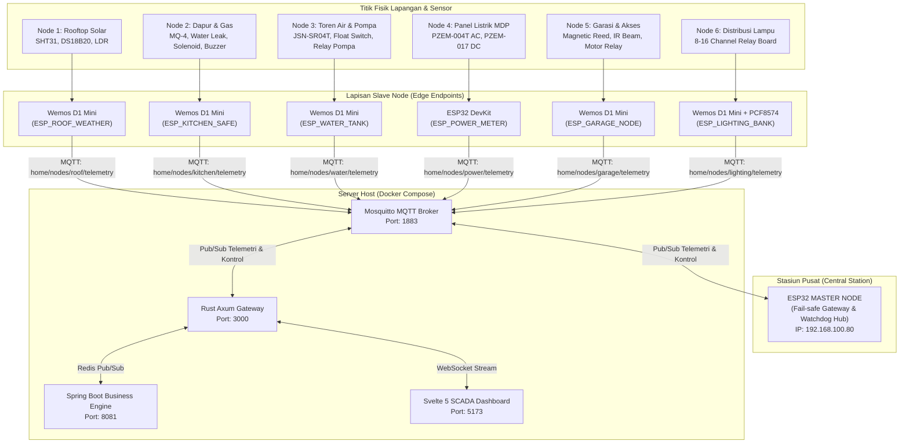

# Spesifikasi Desentralisasi Slave Node & Arsitektur Jaringan IoT

Dokumen ini mendefinisikan arsitektur desentralisasi perangkat keras (*distributed embedded nodes*), di mana **ESP32 Master Node** bertindak sebagai *Central Station / Gateway Hub*, dan fungsi pemantauan serta kontrol fisik didelegasikan ke **Slave Nodes** berbasis **Wemos D1 Mini (ESP8266)** atau **ESP32**.

---

## 1. Prinsip Desain: Pragmatis, Anti-Bloat & Andal

Sesuai filosofi **Ponytail** (kesederhanaan, anti-overengineering) dan standar keselamatan industri:
1. **Pilihan Mikrokontroler Tepat Guna**:
   - **Wemos D1 Mini (ESP8266)** digunakan untuk node dengan kebutuhan I/O ringkas (1–4 sensor/relay), murah, hemat daya, dan tapak fisik kecil.
   - **ESP32** hanya digunakan pada node yang memerlukan banyak hardware UART, ADC presisi tinggi, atau beban komputasi intensif (seperti *Energy & Power Meter*).
2. **Otonomi Darurat Lokal (*Autonomous Fail-Safe*)**:
   - Setiap Slave Node memiliki logika keselamatan mandiri (*local interlock*). Jika terjadi bahaya (kebocoran gas, tangki meluap), node langsung mengambil tindakan pencegahan fisik dalam hitungan milidetik **tanpa menunggu instruksi dari Master, jaringan WiFi, atau server backend**.
3. **Proteksi Komponen Fisik (*Hardware Protection*)**:
   - Isolasi optocoupler pada semua aktuator beban AC/induktif.
   - Flyback diode pada beban koil DC (solenoid gas, relay).
   - Pembagi tegangan (*voltage divider*) 5V ke 3.3V untuk melindungi pin GPIO ESP.
   - Rangkaian snubber RC / MOV untuk meredam lonjakan percikan api (*spark/arcing*) pada kontak relay.
   - Hardware watchdog timer (WDT) untuk pemulihan otomatis jika terjadi crash/hang.

---

## 2. Diagram Topologi Jaringan & Aliran Data

Sistem menggunakan model komunikasi hybrid:
- **Jalur Utama**: Protokol MQTT melalui WiFi lokal (kompatibel langsung dengan Mosquitto broker & Rust gateway).
- **Jalur Cadangan / Watchdog**: ESP32 Master memantau detak jantung (*heartbeat*) dan status LWT (*Last Will and Testament*) setiap slave.



---

## 3. Rincian Slave Nodes & Alokasi Perangkat Keras

### 3.1. Node 1: Rooftop Weather & Solar Station (`esp_roof_weather`)
- **Penempatan**: Atap rumah, dekat rangkaian panel surya (2400 Wp).
- **Mikrokontroler**: **Wemos D1 Mini (ESP8266)**.
  - *Alasan*: Hanya membaca 3 sensor berkecepatan rendah (I2C dan OneWire), tidak membutuhkan banyak pin.
- **Daftar Sensor & Modul**:
  | Komponen | Antarmuka | Pin Wemos D1 | Fungsi |
  | :--- | :--- | :--- | :--- |
  | SHT31 / AHT20 | I2C (3.3V) | D1 (SCL), D2 (SDA) | Suhu dan kelembaban udara luar (`temp_outdoor_c`, `humidity_pct`) |
  | DS18B20 Waterproof | 1-Wire (3.3V) | D4 (GPIO2) + 4.7kΩ Pull-up | Suhu fisik permukaan panel surya (`panel_temp_c`) |
  | LDR Sensor Cahaya | Analog (0–1V) | A0 + Voltage Divider | Pengukur intensitas cahaya matahari (indikasi siang/malam) |
  | Sensor Tetesan Hujan | Digital (3.3V) | D5 (GPIO14) | Deteksi awal hujan untuk alarm jemuran/tutup ventilasi |
- **Proteksi Rangkaian Fisik**:
  - Box Enclosure IP66 tahan cuaca dengan ventilasi anti-kondensasi (*breather vent*).
  - Step-down buck regulator Mini360 (input 12V DC bus atap diturunkan ke 5V stabil). Menghindari panas berlebih dari regulator linear AMS1117.
  - Dioda TVS (SMBJ5.0A) pada input power 5V untuk meredam lonjakan tegangan statis akibat petir tidak langsung.

---

### 3.2. Node 2: Kitchen & Hazard Safety (`esp_kitchen_safe`)
- **Penempatan**: Dapur, dekat tabung gas LPG, kompor, dan pipa wastafel.
- **Mikrokontroler**: **Wemos D1 Mini (ESP8266)**.
  - *Alasan*: Node berfokus pada keselamatan kritis lokal dengan kebutuhan pin minimal.
- **Daftar Sensor & Aktuator**:
  | Komponen | Antarmuka | Pin Wemos D1 | Fungsi |
  | :--- | :--- | :--- | :--- |
  | MQ-4 / MQ-2 (Gas LPG/Metana) | Analog (0–3.3V) | A0 (via Voltage Divider 1kΩ:2kΩ) | Konsentrasi gas dalam PPM (`gas_ppm`) |
  | Sensor Rembesan Air (Probe) | Digital | D5 (GPIO14) + Pull-up 10kΩ | Deteksi kebocoran air di bawah wastafel (`water_leak`) |
  | Optocoupled Relay (1-Ch) | Digital Out | D6 (GPIO12) | Pemutus arus selenoid valve gas 12V (`kitchen_gas`) |
  | Active Piezo Buzzer 85dB | Digital Out | D7 (GPIO13) | Alarm sirene lokal instan saat gas bocor |
- **Skema Keselamatan Otonom (*Local Safety Interlock*)**:
  ```mermaid
  flowchart TD
      START["Loop Pembacaan Sensor (Setiap 200ms)"] --> READ_MQ["Baca Nilai Analog MQ Gas"]
      READ_MQ --> CHECK_PPM{"Gas >= 400 PPM?"}
      CHECK_PPM -- YA (BAHAYA) --> TRIP["1. Trigger CUTOFF Selenoid Gas (D6 = LOW)<br/>2. Bunyikan Buzzer Lokal (D7 = HIGH)<br/>3. Kirim MQTT Status Darurat (QoS 1)"]
      CHECK_PPM -- TIDAK --> CHECK_LEAK{"Water Leak Probe Aktif?"}
      CHECK_LEAK -- YA --> ALERT_LEAK["Kirim Sinyal Peringatan Air Bocor"]
      CHECK_LEAK -- TIDAK --> NORMAL["Kondisi Normal -> Kirim Telemetri Rutin"]
  ```
- **Proteksi Rangkaian Fisik**:
  - **Flyback Diode (1N4007)** dipasang antiparalel pada koil solenoid valve 12V untuk meredam *back-EMF* yang dapat merusak transistor/relay.
  - **Pembagi Tegangan**: Output analog sensor MQ (5V) diturunkan ke rentang aman ADC ESP8266 (0–3.3V) menggunakan resistor 1kΩ dan 2kΩ.
  - Relai berisolasi optocoupler (PC817) dengan jalur ground terpisah antara koil 12V dan sirkuit 3.3V logika mikrokontroler.

---

### 3.3. Node 3: Water Tank & Pump Management (`esp_water_tank`)
- **Penempatan**: Dekat tandon air utama (toren) dan pompa dorong/sumber air tanah.
- **Mikrokontroler**: **Wemos D1 Mini (ESP8266)**.
- **Daftar Sensor & Aktuator**:
  | Komponen | Antarmuka | Pin Wemos D1 | Fungsi |
  | :--- | :--- | :--- | :--- |
  | JSN-SR04T Waterproof Ultrasonic | UART / Trigger-Echo | D1 (Trigger), D2 (Echo via divider) | Pengukur jarak permukaan air (`ultrasonic_distance_cm` & `water_level_pct`) |
  | Pelampung Mekanik (Float Switch) | Digital In | D5 (GPIO14) | Sensor fisik darurat batas atas / bawah (*Hardware Interlock*) |
  | Relai 30A Optocoupler | Digital Out | D6 (GPIO12) | Kontrol daya mesin pompa air AC 220V |
  | Solenoid Diverter Valve | Digital Out | D7 (GPIO13) | Katup pembuangan luberan / bypass filter |
- **Proteksi Rangkaian Fisik**:
  - **Hardwired Failsafe**: Saklar pelampung mekanik (*float switch*) dipasang seri secara fisik dengan jalur relai pompa. Jika air menyentuh batas maksimum, arus relai pompa terputus secara mekanis meskipun program mikrokontroler mengalami crash.
  - **RC Snubber Circuit (100Ω 2W + 100nF 400V)** atau Varistor MOV (14D471K) dipasang paralel pada terminal kontak relai AC untuk menyerap lonjakan busur listrik (*arcing*) dari motor pompa induktif.
  - Resistor pembagi tegangan (1kΩ + 2kΩ) pada pin `Echo` sensor JSN-SR04T karena modul sensor bekerja pada 5V sedangkan pin ESP hanya toleran 3.3V.

---

### 3.4. Node 4: Main Electrical Panel & Solar Energy Meter (`esp_power_meter`)
- **Penempatan**: Panel Distribusi Utama (MDP) & Ruang Inverter/Baterai.
- **Mikrokontroler**: **ESP32 DevKit (30 Pin)**.
  - *Alasan*: Membutuhkan minimal dua Hardware Serial UART independen (UART1 untuk PZEM AC, UART2 untuk PZEM DC / Modbus RS485 Inverter) dan pembacaan frekuensi tinggi tanpa jitter.
- **Daftar Sensor & Modul**:
  | Komponen | Antarmuka | Pin ESP32 | Fungsi |
  | :--- | :--- | :--- | :--- |
  | PZEM-004T v3.0 (AC Meter) | UART1 (Hardware) | GPIO 16 (RX), GPIO 17 (TX) | Tegangan PLN (`mains_voltage`), Arus, Daya Aktif (`house_power_w`), kWh, Frekuensi, PF |
  | PZEM-017 / INA226 (DC Meter) | UART2 (Hardware) | GPIO 25 (RX), GPIO 26 (TX) | Tegangan PV (`pv_array_voltage`), Arus PV (`pv_array_current`), Daya (`pv_power_watts`) |
  | Modbus RS485 Transceiver | Hardware Serial | GPIO 18 (RX), GPIO 19 (TX), GPIO 4 (DE/RE) | Pembacaan data status inverter off-grid & persentase baterai UPS (`ups_battery_pct`) |
  | DS18B20 Temperature | 1-Wire | GPIO 27 + 4.7kΩ Pull-up | Pemantau suhu ruang rak server/inverter (`rack_temp_c`) |
- **Proteksi Rangkaian Fisik**:
  - **Sensor Arus CT Non-Invasif (Split-Core Current Transformer)**: Pembacaan arus AC PZEM-004T menggunakan induksi magnetik tanpa memotong kabel fasa PLN 220V, sehingga 100% aman dan terisolasi galvanis.
  - **Isolasi Optocoupler RS485**: Modul TTL to RS485 dilengkapi konverter DC-DC terisolasi (B0505S) untuk mencegah lonjakan tegangan tanah (*ground loop*) antara solar inverter dan papan mikrokontroler.
  - Pemasangan pada dudukan DIN-Rail dengan casing ABS standar panel industri.

---

### 3.5. Node 5: Garage Access & Security (`esp_garage_node`)
- **Penempatan**: Garasi mobil.
- **Mikrokontroler**: **Wemos D1 Mini (ESP8266)**.
- **Daftar Sensor & Aktuator**:
  | Komponen | Antarmuka | Pin Wemos D1 | Fungsi |
  | :--- | :--- | :--- | :--- |
  | Magnetic Reed Switch (MC-38) | Digital In | D5 (GPIO14) + Pull-up | Deteksi status fisik pintu garasi: terbuka/tertutup (`garage_status`) |
  | IR Obstacle Safety Beam | Digital In | D6 (GPIO12) | Deteksi objek halangan di jalur pintu garasi |
  | Relai 5V Optocoupler (Dry Contact) | Digital Out | D1 (GPIO5) | Pemicu pulsa tombol buka/tutup motor garasi (durasi pulsa 500ms) |
  | Relai Lampu Garasi & Tangga | Digital Out | D2 (GPIO4) | Saklar lampu tangga dan garasi |
- **Proteksi Rangkaian Fisik**:
  - Pemicu motor pintu garasi menggunakan relai *dry contact* berdurasi pulsa sesaat (*momentary pulse* 500ms), bukan status *latch*, untuk mencegah terbakarnya papan kontroler motor garasi.
  - Kapasitor filter 100nF paralel pada saklar magnetik untuk meredam noise (*switch bouncing*) akibat getaran motor garasi.

---

### 3.6. Node 6: Distributed Lighting Banks (`esp_lighting_bank`)
- **Penempatan**: Plafon / Junction Box Lantai 1 & Lantai 2.
- **Mikrokontroler**: **Wemos D1 Mini (ESP8266) + PCF8574 I2C Expander** (atau ESP32).
  - *Alasan*: Mengontrol 8 hingga 16 relai lampu hanya menggunakan 2 pin I2C (`D1/SCL`, `D2/SDA`) dari Wemos D1 Mini, menghasilkan kabel yang sangat rapi dan anti-bloat.
- **Daftar Zona Lampu**:
  1. `living_room` (Ruang Tamu)
  2. `main_room` (Kamar Utama)
  3. `garage` (Garasi)
  4. `kitchen` (Dapur)
  5. `stair_garage` (Tangga Garasi)
  6. `stair_fl2` (Tangga Lantai 2)
  7. `yard_front` (Halaman Depan)
  8. `yard_side` (Halaman Samping)
  9. `yard_back` (Halaman Belakang)
  10. `server_room` (Ruang Server)
  11. `electrical_room` (Ruang Panel Listrik)
- **Proteksi Rangkaian Fisik**:
  - Modul Relai Optocoupler dengan pin jumper `JD-VCC` dilepas: catu daya koil relai (5V) dipisahkan dari daya logika ESP (3.3V).
  - Sekring tabung kaca (*glass fuse*) 2A pada setiap grup fasa lampu untuk proteksi terhadap korsleting fitting bohlam.
  - Varistor MOV pada setiap saklar relai guna menahan lonjakan arus awal (*inrush current*) dari driver bohlam LED modern.

---

## 4. Format Kontrak Komunikasi MQTT Node

Setiap Slave Node mempublikasikan telemetri secara periodik (setiap 1000–3000 ms) ke topiknya masing-masing dan berlangganan ke topik kontrolnya:

### 4.1. Struktur Topik MQTT
- **Telemetri Slave**: `home/nodes/{node_id}/telemetry`
- **Status Koneksi (LWT)**: `home/nodes/{node_id}/status` (payload: `{"status":"ONLINE"|"OFFLINE"}`)
- **Perintah Aktuator**: `home/nodes/{node_id}/control`
- **Master Consolidated Stream**: `home/sensors/telemetry` (diteruskan ke Rust Gateway)

### 4.2. Contoh Payload Telemetri Node Dapur (`home/nodes/esp_kitchen_safe/telemetry`)
```json
{
  "node_id": "esp_kitchen_safe",
  "uptime_sec": 38420,
  "gas_ppm": 142,
  "water_leak": false,
  "gas_valve_open": true,
  "siren_active": false,
  "free_heap_bytes": 42100,
  "wifi_rssi_dbm": -58
}
```

### 4.3. Contoh Payload Telemetri Node Daya (`home/nodes/esp_power_meter/telemetry`)
```json
{
  "node_id": "esp_power_meter",
  "mains_voltage": 224.2,
  "house_power_w": 345.0,
  "pv_voltage": 68.2,
  "pv_current": 12.1,
  "pv_watts": 825.2,
  "battery_pct": 98.0,
  "rack_temp_c": 24.5
}
```

---

## 5. Diagram Alur Keselamatan & Interlock Darurat (Sequence Diagram)

Diagram berikut mengilustrasikan urutan peristiwa saat Node Dapur mendeteksi lonjakan gas LPG, bagaimana tindakan fisik diambil secara instan, serta bagaimana informasi dialirkan ke Master, Backend, dan Notifikasi Telegram/Discord:

```mermaid
sequenceDiagram
    autonumber
    participant S_MQ as Sensor MQ-4
    participant SLAVE_K as Slave Kitchen (Wemos D1)
    participant VALVE as Solenoid Valve & Siren
    participant BROKER as Mosquitto MQTT Broker
    participant MASTER as ESP32 Master Hub
    participant SPRING as Spring Boot Engine
    participant NOTIF as Telegram & Discord Bot
    participant DASH as Svelte 5 Dashboard

    Note over S_MQ,SLAVE_K: Konsentrasi Gas Meningkat > 400 PPM
    S_MQ->>SLAVE_K: Pembacaan Analog Melampaui Batas Ambang
    
    rect rgb(60, 20, 20)
        Note over SLAVE_K,VALVE: HARDWARE INTERLOCK INSTAN (< 10 ms)
        SLAVE_K->>VALVE: Putus Aliran Arus (Tutup Katup Gas)
        SLAVE_K->>VALVE: Aktifkan Sirene Alarm Lokal (Buzzer 85dB)
    end

    SLAVE_K->>BROKER: Publish 'home/nodes/esp_kitchen_safe/telemetry' (gas_ppm=480, hazard=true)
    BROKER->>MASTER: Menerima Peringatan Bahaya
    MASTER->>MASTER: Nyalakan LED Indikator Darurat Merah di Stasiun Pusat
    
    BROKER->>SPRING: Konsumsi Data via Redis Stream
    SPRING->>SPRING: Evaluasi SafetyRuleEngine (Status: HAZARD_CRITICAL)
    
    par Distribusi Notifikasi Darurat
        SPRING->>NOTIF: Kirim Peringatan Prioritas: "BAHAYA KEBOCORAN GAS 480 PPM! KATUP SUDAH DITUTUP!"
        SPRING->>DASH: Push Event Bahaya via WebSocket (Banner Merah & Audio Alert)
    end
```



---

## 6. Ringkasan Kebutuhan Komponen & Hardware Safety Checklist

| Modul Node | Rekomendasi MCU | Jumlah Pin I/O | Komponen Kunci | Proteksi Wajib |
| :--- | :--- | :--- | :--- | :--- |
| **Rooftop Solar** | Wemos D1 Mini (ESP8266) | 4 Pin (I2C + 1-Wire + A0) | SHT31, DS18B20, LDR | Box IP66, TVS Diode, DC Buck Mini360 |
| **Kitchen Safety** | Wemos D1 Mini (ESP8266) | 4 Pin (A0 + 3 Digital) | MQ-4, Sensor Air, Relai, Buzzer | Flyback Diode (1N4007), Pembagi Tegangan ADC 5V->3.3V, Optocoupler |
| **Water Tank** | Wemos D1 Mini (ESP8266) | 4 Pin (Trigger, Echo, 2 Out) | JSN-SR04T, Float Switch, Relai Pompa | Pelampung Fisik Seri (*Hardwired Cutoff*), Snubber RC Kontak AC, Probe IP67 |
| **Power Meter** | ESP32 DevKit (30P) | 8 Pin (Dual UART, RS485, 1-Wire) | PZEM-004T, PZEM-017, MAX485, DS18B20 | Split-Core CT (Non-Invasif), Konverter DC Terisolasi B0505S, Casing DIN-Rail |
| **Garage Node** | Wemos D1 Mini (ESP8266) | 4 Pin (2 In + 2 Relai) | MC-38 Reed, IR Sensor, Relai Pulsa | Pulsa Sesaat 500ms (*No Continuous Latch*), Kapasitor De-bounce 100nF |
| **Lighting Bank** | Wemos D1 Mini (ESP8266) | 2 Pin (I2C ke PCF8574) | PCF8574T, 8-Ch Relai Board | Sekring 2A Kaca Tiap Grup, Pisahkan Jumper `JD-VCC`, MOV Arcing Guard |
