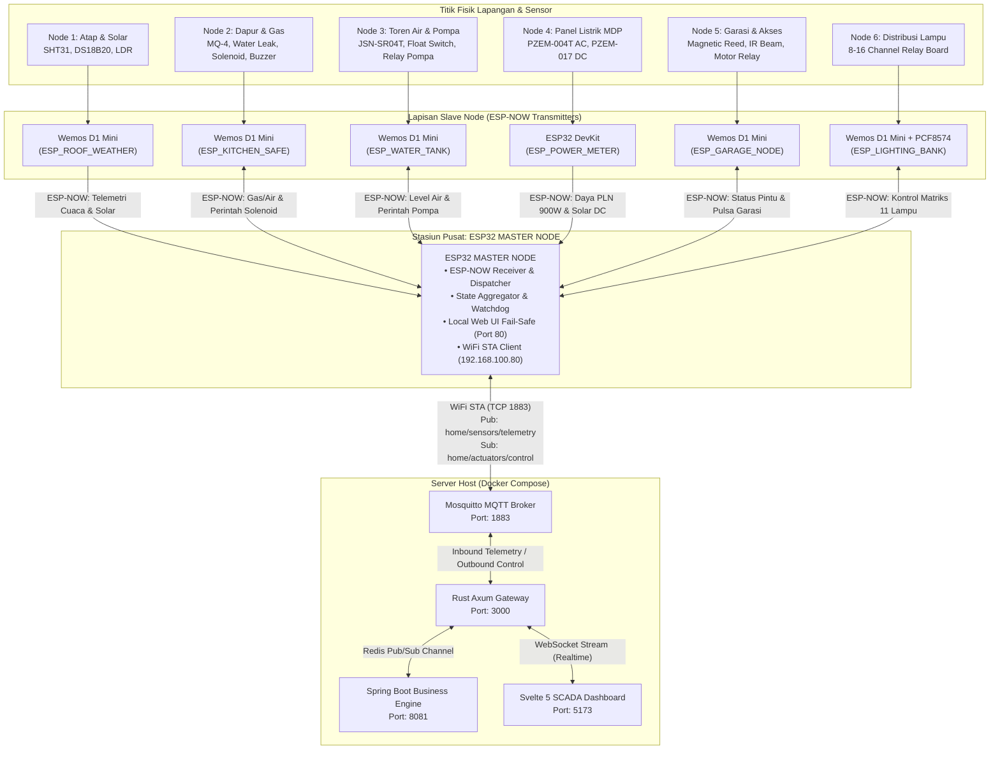
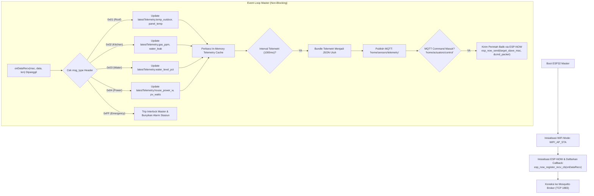

# Spesifikasi Desentralisasi Slave Node & Arsitektur ESP-NOW Hub-and-Spoke

Dokumen ini mendefinisikan arsitektur desentralisasi perangkat keras (*distributed embedded nodes*), di mana **ESP32 Master Node** bertindak sebagai **Central Station & Gateway Hub**, dan seluruh **Slave Nodes** (berbasis **Wemos D1 Mini / ESP8266** dan **ESP32**) berkomunikasi **langsung ke Master menggunakan protokol nirkabel berlatensi rendah: ESP-NOW**.

---

## 1. Mengapa ESP-NOW Langsung ke Master Node?

Alih-alih setiap slave node menyambung ke router WiFi rumah dan membuka koneksi MQTT masing-masing, sistem mengadopsi topologi **Star / Hub-and-Spoke** via **ESP-NOW**:

```
[ Slave Nodes (Wemos D1 / ESP32) ] 
               │
               ▼  (ESP-NOW 2.4GHz MAC-to-MAC, Latensi < 5ms, Tanpa Router)
      [ ESP32 MASTER NODE ] 
               │
               ▼  (WiFi STA tunggal: MQTT + HTTP REST Fail-safe)
  [ Mosquitto Broker & Rust Backend ]
```

### Keunggulan Utama Arsitektur ESP-NOW:
1. **Bebas Ketergantungan Router WiFi Rumah (*Zero Router Dependency*)**:
   - Jika router WiFi rumah hang, mati lampu, atau sedang reboot, **komunikasi antara Slave dan Master tetap berjalan 100%**. Sensor keselamatan gas, deteksi air toren, saklar pintu garasi, dan saklar lampu tetap dapat dikendalikan melalui Master.
2. **Latensi Sub-Milidetik (< 5 ms) & Hemat Daya**:
   - Koneksi WiFi standar membutuhkan *association, authentication, dan DHCP handshake* (memakan waktu 3–5 detik).
   - ESP-NOW mengirim paket langsung pada lapisan MAC (*connectionless action frames*) dalam waktu **< 5 milidetik**. Wemos D1 Mini dapat langsung mengirim telemetri dan kembali ke *deep sleep*.
3. **Mencegah Beban / IP Exhaustion pada Router**:
   - Router rumahan tidak terbebani oleh puluhan IP DHCP dari sensor IoT kecil. Hanya **1 perangkat tunggal (ESP32 Master)** yang mengonsumsi 1 IP di jaringan lokal.
4. **Keamanan Jaringan Berlapis (*Air-Gapped Slaves*)**:
   - Slave nodes tidak memiliki port TCP/IP terbuka dan tidak terhubung ke subnet internet rumah. Seluruh akses kontrol diverifikasi secara terpusat oleh ESP32 Master.
5. **Agregasi Telemetri Terpusat di Master**:
   - ESP32 Master mengumpulkan seluruh paket data dari semua slave, memperbarui cache memori lokal, dan meneruskannya sebagai satu payload telemetri komprehensif ke backend Rust via MQTT `home/sensors/telemetry`.

---

## 2. Diagram Topologi Jaringan & Aliran Data



---

## 3. Rincian Slave Nodes & Alokasi Perangkat Keras

### 3.1. Node 1: Rooftop Weather & Solar Station (`esp_roof_weather`)
- **Penempatan**: Rangkaian panel surya atap (2400 Wp).
- **Mikrokontroler**: **Wemos D1 Mini (ESP8266)**.
  - *Alasan*: Hanya membaca 3 sensor berkecepatan rendah (I2C dan 1-Wire), konsumsi daya sangat rendah, ukuran kompak.
- **Daftar Sensor & Modul**:
  | Komponen | Antarmuka | Pin Wemos D1 | Fungsi |
  | :--- | :--- | :--- | :--- |
  | SHT31 / AHT20 | I2C (3.3V) | D1 (SCL), D2 (SDA) | Suhu dan kelembaban udara luar (`temp_outdoor_c`, `humidity_pct`) |
  | DS18B20 Waterproof | 1-Wire (3.3V) | D4 (GPIO2) + 4.7kΩ Pull-up | Suhu fisik permukaan panel surya (`panel_temp_c`) |
  | LDR Sensor Cahaya | Analog (0–1V) | A0 + Voltage Divider | Pengukur intensitas cahaya matahari (indikasi siang/malam) |
  | Sensor Tetesan Hujan | Digital (3.3V) | D5 (GPIO14) | Deteksi awal hujan untuk alarm jemuran/tutup ventilasi |
- **Proteksi Rangkaian Fisik**:
  - Box Enclosure IP66 tahan cuaca dengan *breather vent*.
  - Step-down buck regulator Mini360 (input 12V DC bus diturunkan ke 5V stabil). Menghindari panas berlebih dari regulator linear AMS1117.
  - Dioda TVS (SMBJ5.0A) pada input power 5V untuk meredam lonjakan tegangan statis akibat petir tidak langsung.

---

### 3.2. Node 2: Kitchen & Hazard Safety (`esp_kitchen_safe`)
- **Penempatan**: Dapur, dekat tabung gas LPG, kompor, dan pipa wastafel.
- **Mikrokontroler**: **Wemos D1 Mini (ESP8266)**.
  - *Alasan*: Node berfokus pada keselamatan kritis lokal dengan kebutuhan pin minimal.
- **Daftar Sensor & Aktuator**:
  | Komponen | Antarmuka | Pin Wemos D1 | Fungsi |
  | :--- | :--- | :--- | :--- |
  | MQ-4 / MQ-2 (Gas LPG/Metana) | Analog (0–3.3V) | A0 (via Voltage Divider 1kΩ:2kΩ) | Konsentrasi gas dalam PPM (`gas_ppm`) |
  | Sensor Rembesan Air (Probe) | Digital | D5 (GPIO14) + Pull-up 10kΩ | Deteksi kebocoran air di bawah wastafel (`water_leak`) |
  | Optocoupled Relay (1-Ch) | Digital Out | D6 (GPIO12) | Pemutus arus selenoid valve gas 12V (`kitchen_gas`) |
  | Active Piezo Buzzer 85dB | Digital Out | D7 (GPIO13) | Alarm sirene lokal instan saat gas bocor |
- **Skema Keselamatan Otonom (*Local Safety Interlock*)**:
  ```mermaid
  flowchart TD
      START["Loop Pembacaan Sensor (Setiap 200ms)"] --> READ_MQ["Baca Nilai Analog MQ Gas"]
      READ_MQ --> CHECK_PPM{"Gas >= 400 PPM?"}
      CHECK_PPM -- YA (BAHAYA) --> TRIP["1. Trigger CUTOFF Selenoid Gas (D6 = LOW)<br/>2. Bunyikan Buzzer Lokal (D7 = HIGH)<br/>3. Kirim ESP-NOW Urgent Frame ke Master"]
      CHECK_PPM -- TIDAK --> CHECK_LEAK{"Water Leak Probe Aktif?"}
      CHECK_LEAK -- YA --> ALERT_LEAK["Kirim ESP-NOW Peringatan Air Bocor"]
      CHECK_LEAK -- TIDAK --> NORMAL["Kondisi Normal -> Kirim Telemetri Rutin via ESP-NOW"]
  ```
- **Proteksi Rangkaian Fisik**:
  - **Flyback Diode (1N4007)** dipasang antiparalel pada koil solenoid valve 12V untuk meredam *back-EMF*.
  - **Pembagi Tegangan**: Output analog sensor MQ (5V) diturunkan ke rentang aman ADC ESP8266 (0–3.3V) menggunakan resistor 1kΩ dan 2kΩ.
  - Relai berisolasi optocoupler (PC817) dengan catu daya koil 12V terpisah dari logika ESP 3.3V.

---

### 3.3. Node 3: Water Tank & Pump Management (`esp_water_tank`)
- **Penempatan**: Dekat tandon air utama (toren) dan pompa dorong/sumber air tanah.
- **Mikrokontroler**: **Wemos D1 Mini (ESP8266)**.
- **Daftar Sensor & Aktuator**:
  | Komponen | Antarmuka | Pin Wemos D1 | Fungsi |
  | :--- | :--- | :--- | :--- |
  | JSN-SR04T Waterproof Ultrasonic | Trigger-Echo | D1 (Trigger), D2 (Echo via divider) | Pengukur jarak permukaan air (`ultrasonic_distance_cm` & `water_level_pct`) |
  | Pelampung Mekanik (Float Switch) | Digital In | D5 (GPIO14) | Sensor fisik darurat batas atas / bawah (*Hardware Interlock*) |
  | Relai 30A Optocoupler | Digital Out | D6 (GPIO12) | Kontrol daya mesin pompa air AC 220V |
  | Solenoid Diverter Valve | Digital Out | D7 (GPIO13) | Katup pembuangan luberan / bypass filter |
- **Proteksi Rangkaian Fisik**:
  - **Hardwired Failsafe**: Saklar pelampung mekanik (*float switch*) dipasang seri secara fisik dengan jalur relai pompa. Jika air menyentuh batas maksimum, arus relai pompa terputus secara mekanis meskipun program mikrokontroler hang.
  - **RC Snubber Circuit (100Ω 2W + 100nF 400V)** atau Varistor MOV (14D471K) dipasang paralel pada terminal kontak relai AC pompa air.
  - Resistor pembagi tegangan (1kΩ + 2kΩ) pada pin `Echo` sensor JSN-SR04T (5V ke 3.3V).

---

### 3.4. Node 4: Main Electrical Panel & Solar Energy Meter (`esp_power_meter`)
- **Penempatan**: Panel Distribusi Utama (MDP) & Ruang Inverter/Baterai.
- **Mikrokontroler**: **ESP32 DevKit (30 Pin)**.
  - *Alasan*: Membutuhkan minimal dua Hardware Serial UART independen (UART1 untuk PZEM AC, UART2 untuk PZEM DC / Modbus RS485 Inverter) dan pembacaan frekuensi tinggi tanpa jitter.
- **Daftar Sensor & Modul**:
  | Komponen | Antarmuka | Pin ESP32 | Fungsi |
  | :--- | :--- | :--- | :--- |
  | PZEM-004T v3.0 (AC Meter) | UART1 (Hardware) | GPIO 16 (RX), GPIO 17 (TX) | Tegangan PLN (`mains_voltage`), Arus, Daya Aktif (`house_power_w`), kWh, Frekuensi, PF |
  | PZEM-017 / INA226 (DC Meter) | UART2 (Hardware) | GPIO 25 (RX), GPIO 26 (TX) | Tegangan PV (`pv_array_voltage`), Arus PV (`pv_array_current`), Daya (`pv_power_watts`) |
  | Modbus RS485 Transceiver | Hardware Serial | GPIO 18 (RX), GPIO 19 (TX), GPIO 4 (DE/RE) | Pembacaan data status inverter off-grid & persentase baterai UPS (`ups_battery_pct`) |
  | DS18B20 Temperature | 1-Wire | GPIO 27 + 4.7kΩ Pull-up | Pemantau suhu ruang rak server/inverter (`rack_temp_c`) |
- **Proteksi Rangkaian Fisik**:
  - **Sensor Arus Non-Invasif (Split-Core CT)**: Pembacaan arus AC PZEM-004T menggunakan induksi magnetik tanpa memotong kabel fasa PLN 220V, sehingga 100% aman dan terisolasi galvanis.
  - **Isolasi Optocoupler RS485**: Modul TTL to RS485 dilengkapi konverter DC-DC terisolasi (B0505S) untuk mencegah lonjakan tegangan tanah (*ground loop*) antara inverter dan ESP32.
  - Casing standar DIN-Rail di dalam panel MDP.

---

### 3.5. Node 5: Garage Access & Security (`esp_garage_node`)
- **Penempatan**: Garasi mobil.
- **Mikrokontroler**: **Wemos D1 Mini (ESP8266)**.
- **Daftar Sensor & Aktuator**:
  | Komponen | Antarmuka | Pin Wemos D1 | Fungsi |
  | :--- | :--- | :--- | :--- |
  | Magnetic Reed Switch (MC-38) | Digital In | D5 (GPIO14) + Pull-up | Deteksi status fisik pintu garasi: terbuka/tertutup (`garage_status`) |
  | IR Obstacle Safety Beam | Digital In | D6 (GPIO12) | Deteksi objek halangan di jalur pintu garasi |
  | Relai 5V Optocoupler (Dry Contact) | Digital Out | D1 (GPIO5) | Pemicu pulsa tombol buka/tutup motor garasi (durasi pulsa 500ms) |
  | Relai Lampu Garasi & Tangga | Digital Out | D2 (GPIO4) | Saklar lampu tangga dan garasi |
- **Proteksi Rangkaian Fisik**:
  - Pemicu motor pintu garasi menggunakan relai *dry contact* berdurasi pulsa sesaat (*momentary pulse* 500ms), bukan status *latch*, untuk mencegah terbakarnya papan kontroler motor garasi.
  - Kapasitor filter 100nF paralel pada saklar magnetik untuk meredam noise (*switch bouncing*) akibat getaran motor garasi.

---

### 3.6. Node 6: Distributed Lighting Banks (`esp_lighting_bank`)
- **Penempatan**: Plafon / Junction Box Lantai 1 & Lantai 2.
- **Mikrokontroler**: **Wemos D1 Mini (ESP8266) + PCF8574 I2C Expander** (atau ESP32).
  - *Alasan*: Mengontrol 8 hingga 16 relai lampu hanya menggunakan 2 pin I2C (`D1/SCL`, `D2/SDA`) dari Wemos D1 Mini, menghasilkan kabel yang sangat rapi dan anti-bloat.
- **Daftar Zona Lampu**:
  1. `living_room` (Ruang Tamu)
  2. `main_room` (Kamar Utama)
  3. `garage` (Garasi)
  4. `kitchen` (Dapur)
  5. `stair_garage` (Tangga Garasi)
  6. `stair_fl2` (Tangga Lantai 2)
  7. `yard_front` (Halaman Depan)
  8. `yard_side` (Halaman Samping)
  9. `yard_back` (Halaman Belakang)
  10. `server_room` (Ruang Server)
  11. `electrical_room` (Ruang Panel Listrik)
- **Proteksi Rangkaian Fisik**:
  - Modul Relai Optocoupler dengan pin jumper `JD-VCC` dilepas: catu daya koil relai (5V) dipisahkan dari daya logika ESP (3.3V).
  - Sekring tabung kaca (*glass fuse*) 2A pada setiap grup fasa lampu.
  - Varistor MOV pada setiap saklar relai guna menahan lonjakan arus awal (*inrush current*) dari driver bohlam LED.

---

## 4. Spesifikasi Kontrak Komunikasi ESP-NOW

ESP-NOW mentransmisikan data dalam bentuk paket biner (*packed struct*) berukuran maksimal 250 byte. Format ini **jauh lebih cepat dan hemat memori** daripada mem-parse JSON di mikrokontroler.

### 4.1. Header Paket Standar ESP-NOW
Setiap paket yang dikirimkan antara Slave dan Master memiliki header identifikasi 4 byte:

```cpp
// Message Types
enum MessageType : uint8_t {
  MSG_TELEMETRY_ROOF    = 0x01,
  MSG_TELEMETRY_KITCHEN = 0x02,
  MSG_TELEMETRY_WATER   = 0x03,
  MSG_TELEMETRY_POWER   = 0x04,
  MSG_TELEMETRY_GARAGE  = 0x05,
  MSG_TELEMETRY_LIGHTS  = 0x06,
  MSG_CMD_ACTUATOR      = 0x10, // Downstream: Master -> Slave
  MSG_EMERGENCY_ALERT   = 0xFF  // Upstream Prioritas Tinggi
};

struct __attribute__((packed)) PacketHeader {
  uint8_t  msg_type;     // Sesuai enum MessageType
  uint8_t  node_id;      // ID numerik unik node (1 s/d 6)
  uint16_t seq_number;   // Sequence counter untuk deteksi paket hilang
};
```

### 4.2. Struktur Payload Telemetri per Node

```cpp
// 1. Payload Node Cuaca & Atap (~14 bytes)
struct __attribute__((packed)) RoofTelemetryPacket {
  PacketHeader header;
  float temp_outdoor;
  float humidity;
  float panel_temp;
  uint16_t ldr_raw;
  bool is_raining;
};

// 2. Payload Node Dapur & Gas (~9 bytes)
struct __attribute__((packed)) KitchenTelemetryPacket {
  PacketHeader header;
  uint16_t gas_ppm;
  bool water_leak;
  bool gas_valve_open;
  bool siren_active;
};

// 3. Payload Node Toren Air (~11 bytes)
struct __attribute__((packed)) WaterTelemetryPacket {
  PacketHeader header;
  float distance_cm;
  uint8_t water_level_pct;
  bool pump_running;
  bool float_switch_triggered;
};

// 4. Payload Node Daya & Solar (~24 bytes)
struct __attribute__((packed)) PowerTelemetryPacket {
  PacketHeader header;
  float mains_voltage;
  float house_power_w;
  float pv_voltage;
  float pv_current;
  float battery_pct;
  float rack_temp;
};

// 5. Downstream: Perintah Aktuator dari Master ke Slave (~6 bytes)
struct __attribute__((packed)) ActuatorCommandPacket {
  PacketHeader header;
  uint8_t target_actuator_id; // misal: 1=Relay1, 2=Valve, 3=Garage
  uint8_t action;             // 0=OFF, 1=ON, 2=PULSE_500MS
};
```

---

## 5. Peran & Alur Kerja ESP32 Master Node

ESP32 Master beroperasi dalam mode **Dual-Radio Konkuren**:
1. **ESP-NOW Receiver**: Terus mendengarkan paket masuk dari MAC address slave yang terdaftar pada channel WiFi yang sama.
2. **WiFi Station (STA)**: Terhubung ke router WiFi lokal untuk komunikasi MQTT dengan server backend dan menyediakan Web Server internal di port 80.



---

## 6. Diagram Alur Keselamatan Interlock (Sequence Diagram via ESP-NOW)

```mermaid
sequenceDiagram
    autonumber
    participant S_MQ as Sensor MQ-4 Dapur
    participant SLAVE_K as Slave Kitchen (Wemos D1)
    participant VALVE as Solenoid Valve & Siren
    participant MASTER as ESP32 Master Hub
    participant BROKER as Mosquitto MQTT Broker
    participant SPRING as Spring Boot Engine
    participant NOTIF as Telegram & Discord Bot
    participant DASH as Svelte 5 Dashboard

    Note over S_MQ,SLAVE_K: Gas Melonjak > 400 PPM
    S_MQ->>SLAVE_K: Pembacaan Analog Melampaui Ambang

    rect rgb(60, 20, 20)
        Note over SLAVE_K,VALVE: HARDWARE INTERLOCK LOKAL (< 10 ms)
        SLAVE_K->>VALVE: Putus Aliran Arus (Tutup Katup Gas 12V)
        SLAVE_K->>VALVE: Bunyikan Buzzer Lokal 85dB
    end

    Note over SLAVE_K,MASTER: TRANSMISI ESP-NOW (< 3 ms, TANPA ROUTER)
    SLAVE_K->>MASTER: Kirim Paket ESP-NOW (MSG_EMERGENCY_ALERT, gas_ppm=480)
    MASTER->>MASTER: Nyalakan LED Bahaya Merah & Buzzer Stasiun Master

    Note over MASTER,BROKER: Diteruskan ke Jaringan Rumah via MQTT
    MASTER->>BROKER: Publish 'home/sensors/telemetry' (gas_ppm=480, status=HAZARD)
    BROKER->>SPRING: Konsumsi Data via Redis Stream
    SPRING->>SPRING: Evaluasi SafetyRuleEngine (Status: HAZARD_CRITICAL)

    par Distribusi Notifikasi Darurat
        SPRING->>NOTIF: Kirim Peringatan: "BAHAYA KEBOCORAN GAS 480 PPM! KATUP SUDAH DITUTUP!"
        SPRING->>DASH: Push Event Bahaya via WebSocket (Banner Merah & Audio Alert)
    end
```



---

## 7. Ringkasan Kebutuhan Komponen & Hardware Safety Checklist

| Modul Node | Rekomendasi MCU | Protokol ke Master | Komponen Kunci | Proteksi Wajib |
| :--- | :--- | :--- | :--- | :--- |
| **Rooftop Solar** | Wemos D1 Mini (ESP8266) | **ESP-NOW** | SHT31, DS18B20, LDR | Box IP66, TVS Diode, DC Buck Mini360 |
| **Kitchen Safety** | Wemos D1 Mini (ESP8266) | **ESP-NOW** | MQ-4, Sensor Air, Relai, Buzzer | Flyback Diode (1N4007), Pembagi Tegangan ADC 5V->3.3V, Optocoupler |
| **Water Tank** | Wemos D1 Mini (ESP8266) | **ESP-NOW** | JSN-SR04T, Float Switch, Relai Pompa | Pelampung Fisik Seri (*Hardwired Cutoff*), Snubber RC Kontak AC, Probe IP67 |
| **Power Meter** | ESP32 DevKit (30P) | **ESP-NOW** | PZEM-004T, PZEM-017, MAX485, DS18B20 | Split-Core CT (Non-Invasif), Konverter DC Terisolasi B0505S, Casing DIN-Rail |
| **Garage Node** | Wemos D1 Mini (ESP8266) | **ESP-NOW** | MC-38 Reed, IR Sensor, Relai Pulsa | Pulsa Sesaat 500ms (*No Continuous Latch*), Kapasitor De-bounce 100nF |
| **Lighting Bank** | Wemos D1 Mini (ESP8266) | **ESP-NOW** | PCF8574T, 8-Ch Relai Board | Sekring 2A Kaca Tiap Grup, Pisahkan Jumper `JD-VCC`, MOV Arcing Guard |
| **ESP32 Master** | ESP32 DevKit / NodeMCU-32S | **ESP-NOW + WiFi STA** | Layar OLED / LED Status, Buzzer | Catu Daya 5V 2A Stabil, Filter Kapasitor 1000µF, Watchdog Timer Aktif |

---

## 8. Panduan Penguatan Sistem Lapangan (Robustness & Anti-Bloat)

Berikut adalah mitigasi kegagalan teknis nyata di lapangan berdasarkan prinsip **Ponytail** (solusi terkecil dan paling tangguh tanpa menambah pustaka/kode berlebih):

### 8.1. Perangkap Saluran Radio (*WiFi Channel Drift*)
- **Masalah**: ESP32 Master terhubung ke router WiFi rumah dalam mode STA. Jika router me-reboot dan otomatis berpindah saluran (misal dari Channel 1 ke Channel 6), radio Master ikut berpindah ke Channel 6. Seluruh Slave yang terkunci di Channel 1 akan **seketika putus kontak (deaf/blind)**.
- **Solusi Praktis**:
  1. Kunci konfigurasi router WiFi rumah pada saluran statis: **Pilih Channel 6 atau 1 (Static 20 MHz, bukan Auto)**.
  2. Tambahkan logika *Channel Sweeping* sederhana pada Slave: Jika pengiriman ESP-NOW gagal 5 kali berturut-turut, Slave memindai channel 1 s/d 13 sampai mendapat respon dari Master sebelum kembali ke mode tidur.

### 8.2. Hindari Hardcoding MAC Address Master
- **Masalah**: Jika papan ESP32 Master rusak akibat lonjakan petir dan diganti papan cadangan baru, MAC address radio berubah. Sangat tidak efisien jika harus men-flash ulang firmware 6 slave node di lapangan.
- **Solusi Praktis**:
  - Slave mengirim telemetri periodik ke **Broadcast MAC Address (`FF:FF:FF:FF:FF:FF`)**.
  - ESP32 Master cukup mendaftarkan peer broadcast satu kali saat inisialisasi. Master dapat menerima paket dari slave mana pun tanpa perlu pairing MAC manual yang kaku.

### 8.3. Meredam Lonjakan Arus RF (*Brownout Reset Guard*)
- **Masalah**: Pemancar radio ESP menarik arus sesaat (*burst spike*) sebesar 200–350 mA dalam rentang 2 ms saat memancarkan paket ESP-NOW. Jika jalur kabel 5V agak panjang atau adaptor USB berkualitas rendah, tegangan drop seketika di bawah 2.8V memicu *brownout reset* berulang kali.
- **Solusi Praktis**:
  - Pasang kapasitor elektrolit **470 µF – 1000 µF / 16V (Low ESR)** paralel dengan kapasitor keramik **100 nF** sedekat mungkin dengan pin `5V/VIN` dan `GND` pada setiap Wemos D1 Mini. Ini menyerap *spike* tanpa perlu mengganti adaptor mahal.

### 8.4. Aturan Pin Bootstrapping Wemos D1 Mini (ESP8266)
- **Masalah**: ESP8266 memiliki pin kontrol *boot state*:
  - `D3 (GPIO0)` ditarik LOW $\rightarrow$ ESP masuk flash mode (gagal boot normal).
  - `D8 (GPIO15)` ditarik HIGH $\rightarrow$ ESP menolak booting.
  - `D4 (GPIO2)` ditarik LOW $\rightarrow$ ESP gagal boot normal.
- **Solusi Praktis**:
  - **Pin Bebas Aman (Safe Pins)** untuk relay/sensor: **`D1 (GPIO5)`**, **`D2 (GPIO4)`**, **`D5 (GPIO14)`**, **`D6 (GPIO12)`**, dan **`D7 (GPIO13)`**.
  - Jangan menghubungkan relai aktif LOW ke pin D3 atau D4! Gunakan pin aman di atas untuk menjamin node selalu hidup normal setelah mati listrik.

### 8.5. Watchdog Data Usang (*Stale Data Guard*) di Master
- **Masalah**: Jika salah satu slave kehabisan daya atau rusak, Master tidak boleh terus mempublikasikan data pembacaan terakhir seolah-olah node masih hidup.
- **Solusi Praktis**:
  - Master menyimpan timestamp `last_seen_ms[node_id]`.
  - Jika `(millis() - last_seen_ms[node_id]) > 10000` (tidak ada kabar dalam 10 detik), tandai variabel sensor node tersebut sebagai nilai tidak valid (`null / NaN`) dan ubah status perangkat menjadi `OFFLINE` di dashboard.

### 8.6. Transmisi Beruntun untuk Sinyal Darurat (*Burst Redundancy*)
- **Masalah**: Transmisi broadcast ESP-NOW tidak memiliki jaminan ACK bawaan dari lapisan MAC.
- **Solusi Praktis**:
  - Khusus untuk paket darurat (`MSG_EMERGENCY_ALERT`, misalnya kebocoran gas > 400 PPM), slave memancarkan **3 paket berurutan dengan jeda 20 ms** (*burst redundancy*). Hal ini memastikan sinyal 99.9% tembus ke Master meskipun ada interferensi RF sekilas.

