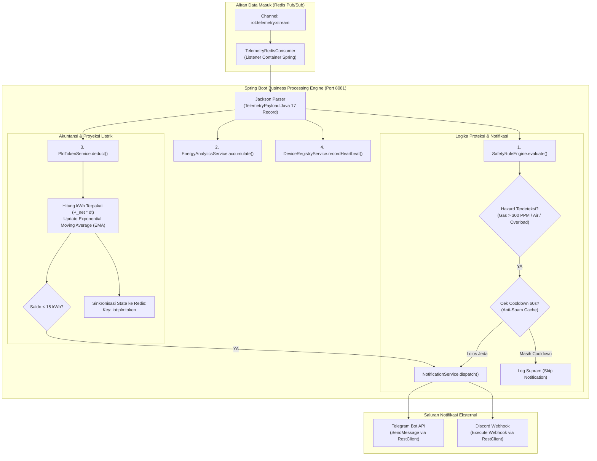

# Layanan: Spring Boot Business Engine (`Service_Business_Java`)

Dokumen teknis ini menjelaskan arsitektur, struktur paket, logika aturan keselamatan (*Safety Rule Engine*), akuntansi energi, pelacak kuota token listrik PLN prabayar, pengelolaan profil rumah (*Scene Engine*), dan sistem notifikasi instan pada **Spring Boot Business Engine** (Port `8081`).

---

## 1. Peran & Tanggung Jawab Layanan

Layanan Spring Boot bertindak sebagai pusat pemrosesan logika bisnis (*business core*) yang mengonsumsi data dari antrean Redis dan mengevaluasi aturan secara mandiri:

1. **Konsumsi Stream Telemetri Asinkron**: Mendengarkan channel Redis Pub/Sub `iot:telemetry:stream` dan `iot:device:status` yang diteruskan oleh Rust Gateway.
2. **Evaluasi Aturan Keselamatan (*Safety Rule Engine*)**:
   - *PLN 900W Overload Guard*: Memantau beban daya riil. Mengirim peringatan jika beban mendekati kapasitas limit 900 Watt (> 860 W) untuk mencegah pemutus MCB PLN trip.
   - *Hazard Interlock*: Memantau sensor gas MQ-4 (> 300 PPM) dan probe kebocoran air untuk memicu peringatan darurat seketika.
   - *Solar Optimization*: Mendeteksi surplus daya panel surya (> 300 W di atas beban saat baterai > 95%) untuk pemanfaatan beban sekunder.
3. **Pelacak & Peramal Kuota Token Listrik PLN**:
   - Melacak sisa saldo pulsa listrik PLN prabayar dalam satuan kWh dan Rupiah.
   - Memotong kuota secara presisi pada setiap paket telemetri masuk berdasarkan daya riil PLN.
   - Menghitung laju pemakaian rata-rata (*burn-rate*) dan memproyeksikan estimasi sisa hari sebelum listrik padam.
4. **Distribusi Notifikasi Terpadu (Telegram & Discord)**:
   - Mengirim notifikasi bahaya kritis dan status sistem langsung ke Telegram Bot dan Discord Webhook dengan pembatas frekuensi (*anti-spam cooldown throttling* 60 detik).
   - Melacak transisi status aktuator utama secara instan: perubahan status Panel Surya (ON/OFF), Sirene Alarm Darurat, Pemutus Arus Dapur (Kitchen Breaker), dan Pintu Garasi (saklar lampu sengaja dikecualikan agar tidak membanjiri channel obrolan).
5. **Inventaris Perangkat (*Device Registry*)**:
   - Mengelola metadata perangkat (nama alias, ruangan, tipe, status aktif) yang tersimpan secara terpusat pada Redis Hash `iot:registry:devices`.
6. **Pengelola Profil Rumah (*Scene Engine*)**:
   - Menyediakan pergantian profil operasional rumah tangga satu-klik: `ALL_OFF`, `DAY_MODE`, `NIGHT_MODE`, dan `SOLAR_PRIORITY`.

---

## 2. Diagram Alur Pemrosesan Data & Evaluasi Aturan



---

## 3. Model Matematika Akuntansi Energi & Peramalan Token PLN

Layanan ini mengimplementasikan kalkulasi presisi untuk pemantauan energi dan penghematan biaya listrik rumah tangga:

### 3.1. Penentuan Daya Bersih Jaringan PLN ($P_{net}$)
Untuk mencegah penghitungan ganda saat panel surya aktif menyuplai listrik rumah tangga, daya bersih yang ditarik dari meteran PLN dihitung dengan:

$$P_{net} = \max\left(0, P_{house} - P_{solar}\right)$$

*Keterangan:*
- $P_{house}$: Daya aktif total konsumsi rumah tangga (Watt).
- $P_{solar}$: Daya aktif output pembangkitan panel surya (Watt).
- Jika $P_{solar} \ge P_{house}$, daya PLN bernilai $0\text{ W}$ (rumah beroperasi 100% mandiri dari solar).

### 3.2. Akumulasi Energi Listrik Terpakai ($\Delta E$)
Pada setiap interval data telemetri yang masuk, durasi waktu ($\Delta t$) dihitung dari selisih waktu sistem:

$$\Delta t = \frac{t_{kini} - t_{sebelumnya}}{3{,}600{,}000} \quad (\text{jam})$$

Energi listrik PLN yang terbakar dalam interval tersebut adalah:

$$\Delta E_{kWh} = \frac{P_{net} \times \Delta t}{1000} \quad (\text{kWh})$$

### 3.3. Pengurangan Saldo Kuota Token Prabayar ($E_{rem}$)
Saldo kuota energi meteran listrik berkurang secara dinamis setiap detik:

$$E_{rem}(t) = \max\left(0, E_{rem}(t - \Delta t) - \Delta E_{kWh}\right)$$

Jika saldo $E_{rem}$ menyentuh ambang batas kritis (default: $15.0\text{ kWh}$), sistem otomatis menerbitkan peringatan prioritas tinggi ke bot Telegram dan Discord.

### 3.4. Laju Pemakaian Rata-Rata Bergerak Eksponensial ($EMA_{burn}$)
Beban konsumsi listrik rumah tangga berfluktuasi tajam saat peralatan seperti kompresor AC, kulkas, atau pompa air menyala. Untuk menghasilkan proyeksi yang stabil tanpa terpengaruh lonjakan sesaat (*spike*), laju konsumsi harian dihitung menggunakan *Exponential Moving Average (EMA)* dengan bobot riwayat $95\%$ dan proyeksi interval kini $5\%$:

$$P_{proj} = \frac{P_{net} \times 24}{1000} \quad (\text{kWh/hari})$$

$$EMA_{burn}(t) = \left(0.95 \times EMA_{burn}(t - \Delta t)\right) + \left(0.05 \times P_{proj}\right)$$

### 3.5. Estimasi Sisa Hari Pemakaian Listrik ($T_{sisa}$)
Hari tersisa hingga pulsa listrik padam dihitung dengan membagi saldo tersisa terhadap laju konsumsi rata-rata bergerak:

$$T_{sisa} = \begin{cases} \frac{E_{rem}(t)}{EMA_{burn}(t)}, & \text{jika } EMA_{burn}(t) > 0 \\ \infty, & \text{jika } EMA_{burn}(t) = 0 \end{cases}$$

### 3.6. Valuasi Finansial & Penghematan Panel Surya
Berdasarkan regulasi tarif tenaga listrik PLN untuk pelanggan rumah tangga reguler (Golongan R-1/900 VA non-subsidi, tarif per kWh dasar: $\text{Rp } 1.352/\text{kWh}$):

$$\text{Saldo}_{\text{IDR}} = E_{rem} \times 1.352$$

$$\text{Penghematan Solar}_{\text{IDR}} = E_{solar} \times 1.352$$

Tingkat kemandirian energi rumah tangga (*Self-Sufficiency Rate*) dihitung dengan:

$$\text{Self-Sufficiency} = \frac{E_{solar}}{E_{PLN} + E_{solar}} \times 100\%$$

### 3.7. Isi Ulang Token Berdasarkan Nilai Rupiah
Saat pengguna melakukan isi ulang (*recharge*) dengan nominal uang, penambahan kuota kWh dihitung otomatis:

$$\Delta E_{tambah} = \frac{\text{Nominal}_{\text{IDR}}}{1.352} \quad (\text{kWh})$$

---

## 4. Struktur Paket & Arsitektur Kelas

Sistem menerapkan arsitektur bersih (*Clean Architecture*) memanfaatkan fitur **Java 17 Records** yang bersifat *immutable* dan hemat memori:

```
Service_Business_Java/src/main/java/com/homeiot/business/
├── BusinessEngineApplication.java       # Titik masuk utama Spring Boot
├── config/
│   ├── RedisConfig.java                 # Registrasi listener container Redis Pub/Sub
│   └── WebConfig.java                   # Konfigurasi CORS & REST Web Layer
├── consumer/
│   └── TelemetryRedisConsumer.java      # Listener stream Redis (iot:telemetry:stream)
├── controller/
│   ├── AnalyticsController.java         # REST API analitik energi & status proteksi
│   ├── DeviceController.java            # REST API inventaris & nama alias perangkat
│   ├── HealthController.java            # Health check probe
│   ├── PlnTokenController.java          # REST API kuota token & endpoint recharge
│   └── SceneController.java             # REST API kontrol mode rumah tangga (Scenes)
├── device/
│   ├── Device.java                      # Record representasi perangkat (ID, ruang, status)
│   └── DeviceRegistryService.java       # Pengelola status kehadiran perangkat di Redis Hash
├── domain/
│   ├── DeviceStatusEvent.java           # Record event perubahan status LWT
│   ├── EnergySummary.java               # Record ringkasan akuntansi energi harian
│   └── TelemetryPayload.java            # Record representasi data sensor mentah
├── notification/
│   ├── AlertEvent.java                  # Record payload pesan notifikasi & severity level
│   └── NotificationService.java         # RestClient dispatcher ke Telegram Bot & Discord
├── rules/
│   ├── RuleEvaluationResult.java        # Record hasil inspeksi ambang batas keselamatan
│   └── SafetyRuleEngine.java            # Evaluator interlock beban PLN 900W, gas, & air
├── scene/
│   ├── SceneEngineService.java          # Engine transisi profil mode rumah tangga
│   └── SceneStatus.java                 # Record status mode aktif saat ini
├── scheduler/
│   └── LampAutomationScheduler.java     # Penjadwal otomatisasi lampu luar (@Scheduled)
├── service/
│   └── EnergyAnalyticsService.java      # Kalkulator konsumsi kWh harian & efisiensi surya
└── token/
    ├── PlnTokenService.java             # Layanan pelacak kuota token, burn-rate, & persitensi
    ├── RechargeRequest.java             # Record DTO permintaan isi ulang saldo pulsa
    └── TokenStatus.java                 # Record DTO proyeksi hari dan saldo terkini
```

---

## 5. Mekanisme Proteksi Anti-Spam Notifikasi (*Cooldown Throttling*)

Pengiriman peringatan ke bot obrolan dilengkapi dengan penyaring waktu jeda (*cooling-down window*) berdurasi **60 detik** per jenis insiden (`alertKey`):
- Jika sensor gas MQ-4 terus membaca 450 PPM setiap 1 detik, bot hanya mengirim pesan pada detik pertama.
- Pesan berikutnya ditahan (*throttled*) hingga 60 detik berlalu, mencegah kebanjiran notifikasi (*alert fatigue*) pada smartphone pengguna dan pemblokiran rate limit dari Telegram/Discord API.

---

## 6. Konfigurasi Lingkungan (`application.yml`)

Seluruh parameter keselamatan dan batas ambang dapat disesuaikan tanpa perlu mengompilasi ulang kode:

```yaml
server:
  port: 8081

spring:
  application:
    name: home-iot-business-engine
  data:
    redis:
      host: ${REDIS_HOST:localhost}
      port: ${REDIS_PORT:6379}

iot:
  rules:
    pln-limit-watts: 900.0          # Batas kapasitas daya meteran PLN
    pln-warning-threshold: 860.0    # Ambang batas peringatan kelebihan beban
    gas-ppm-threshold: 300          # Ambang batas bahaya gas bocor
    pln-tariff-per-kwh: 1352.0      # Tarif dasar listrik PLN R-1/900 VA (Rp/kWh)
  notification:
    cooldown-seconds: 60            # Jendela pendinginan notifikasi anti-spam
    telegram:
      bot-token: ${TELEGRAM_BOT_TOKEN:}
      chat-id: ${TELEGRAM_CHAT_ID:}
    discord:
      webhook-url: ${DISCORD_WEBHOOK_URL:}
  token:
    low-balance-threshold-kwh: 15.0 # Saldo batas bawah pemicu alarm isi ulang
```

---

## 7. Referensi Resmi & Landasan Regulasi

1. **Spring Boot 3.3 Reference Documentation**: [https://docs.spring.io/spring-boot/docs/3.3.x/reference/html/](https://docs.spring.io/spring-boot/docs/3.3.x/reference/html/)
2. **Spring Data Redis Framework**: [https://docs.spring.io/spring-data/redis/reference/](https://docs.spring.io/spring-data/redis/reference/)
3. **Regulasi Tarif Tenaga Listrik PT PLN (Persero)**: Peraturan Menteri ESDM Republik Indonesia tentang Penetapan Tarif Tenaga Listrik Golongan Rumah Tangga Daya 900 VA (R-1/900 VA Non-Subsidi: $\text{Rp } 1.352/\text{kWh}$). [https://web.pln.co.id/pelanggan/tarif-tenaga-listrik](https://web.pln.co.id/pelanggan/tarif-tenaga-listrik)
4. **RFC 6585 - Additional HTTP Status Codes**: [https://datatracker.ietf.org/doc/html/rfc6585](https://datatracker.ietf.org/doc/html/rfc6585)
5. **Telegram Bot API Documentation**: [https://core.telegram.org/bots/api](https://core.telegram.org/bots/api)
6. **Discord Webhook Developer Guide**: [https://discord.com/developers/docs/resources/webhook](https://discord.com/developers/docs/resources/webhook)
